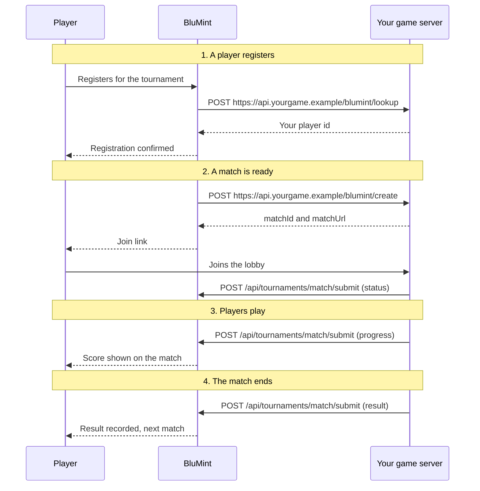

import LookupRequest from "/snippets/contract/examples/lookup.request.mdx";
import LookupAnswer from "/snippets/contract/examples/lookup.answer.mdx";
import CreateBody from "/snippets/contract/examples/create.body.mdx";
import CreateAnswer from "/snippets/contract/examples/create.answer.mdx";
import SubmitProgress from "/snippets/contract/examples/submit.progress.mdx";
import SubmitResult from "/snippets/contract/examples/submit.result.mdx";
import SubmitAbort from "/snippets/contract/examples/submit.abort.mdx";

How the callbacks and the reports fit together is best understood by walking through four points of a tournament.

## 1. Player registration

A player registers. If BluMint identifies your players by your own player ids, BluMint POSTs your lookup URL when a player registers for one of your game's tournaments, and again before each create, to get the player's current id.

BluMint sends one lookup per player, with one key for each authentication method you chose in the setup form that the player has linked on BluMint, holding that account's id:

- Method: `POST`
- URL: your `lookupPlayerUrl`, for example `https://api.yourgame.example/blumint/lookup`
- Body:

<LookupRequest />

Your lookup answers `200` with your player id for each key you recognize:

<LookupAnswer />

This response indicates that:

1. You have a player whose linked Discord account has the id `274220342558756145`.
2. That player's id in your game is `emb1_example`, and each create identifies them by it as `{ "inGameId": "emb1_example" }`.

When you don't recognize the player, answer `[]` for the key, and before they can register, BluMint asks the player to open your connect page from BluMint, approve the same account they linked to BluMint, and then check again:

<Frame caption="What your players see on BluMint when your lookup doesn't find them">
  <video autoPlay muted loop playsInline aria-label="A player presses Join on BluMint, the Approve your Discord account for Ember dialog opens with Open Ember and Check again, and Check again registers them" poster="/images/shared/connect-account.png" src="/images/shared/connect-account.mp4"></video>
</Frame>

Every answer and its effect is in [Player lookup](/guide/player-lookup).

## 2. Starting a match

A match is ready, and BluMint asks your server to create a lobby. BluMint POSTs your create-lobby URL with the teams and their players, the host's match settings ([Match settings](/guide/create-a-lobby#match-settings)), how long players have to be ready (`readyWithinSeconds`), and, on a best-of series, how many game sessions a team must win:

- Method: `POST`
- URL: your `createMatchUrl`, for example `https://api.yourgame.example/blumint/create`
- Body, here on an integration that identifies players by their linked Discord accounts, as the rest of this walkthrough does. On an integration that identifies players by your own ids, each player carries one identity such as `{ "inGameId": "emb1_example" }` instead, holding the id your lookup answered ([Create a lobby](/guide/create-a-lobby)):

<CreateBody />

Your game server creates the lobby and answers `200` with your lobby's id (`matchId`) and the way players get in, here a join link (`matchUrl`):

<CreateAnswer />

This response indicates that:

1. You created a lobby for this BluMint match, and your id for it is `4f9c2a7e`.
2. Players join it by opening `https://play.yourgame.example/j#ABCD-EFGH-IJKL`.

BluMint tells every player the create identifies that their match is ready, and their match card carries your link:

<Frame caption="The push notification your players get">
  
</Frame>

<Frame caption="What your players see on BluMint, one press from your lobby">
  
</Frame>

Only the players the create identifies may play in the lobby, even when someone else learns the link or the lobby code. Otherwise a player could share it with a friend who joins their team to help them win. When your own game client puts players into the lobby, BluMint sends players no link and offers the host your watch-only link instead. The three ways players get in, who receives each, and the rules on retries are in [Create a lobby](/guide/create-a-lobby#create-answer).

## 3. Match in progress

Players play, and you report each game session. Every report names your `matchId` and, as `idempotencyKey`, the `Idempotency-Key` of the create that made the lobby. On a best-of series, after each game session that does not decide the match, your game server POSTs a `progress` report to `/api/tournaments/match/submit` with your API key, giving each team's game sessions won so far:

<SubmitProgress />

Each team's `wins` is its running total after that game session, counting its `startingWins`, never that one game session's outcome. BluMint shows the score on the match at once. On single game sessions, a lobby holds one game session, so you send no progress reports.

<Frame caption="A progress report's score on the player's match card, the moment you send it">
  <video autoPlay muted loop playsInline aria-label="A player's Current match card on BluMint, best of 3, its score changing from 0-0 to 0-1 as the progress report arrives" poster="/images/tournament-lifecycle/score-on-match.png" src="/images/tournament-lifecycle/score-on-match.mp4"></video>
</Frame>

On both kinds, you also send a status report on every presence change: when each player arrives or leaves, when a player becomes ready for the next game session, and after each game session. Your create answer counts as the first one, with every player absent ([Status reports](/guide/report-what-happened#status-reports)).

## 4. Ending a match

The match ends, and you report the result. When a game session decides the match, your game server POSTs the `result` to the same endpoint:

<SubmitResult />

BluMint records the result and moves the tournament on, and each player's next match starts the same way. On single game sessions, each team carries its `placement` instead of `wins`.

### Request a new lobby {#request-a-new-lobby}

If a match can't be completed, for example because your game server failed partway through, send an `abort` with `retryable: true`. BluMint then asks your server for a new lobby for the same match, and on a best-of series the new create carries the game sessions each team already won (`startingWins`), so the match continues where it stopped:

<SubmitAbort />

The same applies if BluMint identifies your players by your own player ids and your service lets a player move a linked account to another of your player ids, for example on a new PC: a lobby seating the old id can no longer be played. End each such live lobby with an `abort` carrying `retryable: true` and, on a best-of series, each team's `wins` so far. BluMint then looks every player up again ([Player lookup](/guide/player-lookup)) and asks you for a new lobby that seats the new id, at most two new lobbies per match before the host takes it. Tell the player that moving ends their live match and that it restarts from the score so far.

A successful report answers `200`. Every report, its answers and its refusals are in [Report what happened](/guide/report-what-happened).

## Summary diagram {#summary-diagram}

